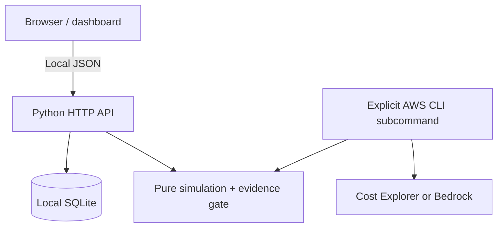

# Architecture decisions

## Boundaries

The browser-facing server **never imports or calls** the AWS integration. It binds to `127.0.0.1` by default. Cloud resources are untouched until an operator separately executes an opt-in command.

## Savings waterfall

Let `N` be requests in a time window, `I` input tokens/request, `O` output tokens/request, and `P_i`, `P_o` model prices per 1 million tokens.

Baseline cost = `N × (I × P_i + O × P_o) / 1,000,000`.

Trim stage scales input/output separately. Cache stage treats a portion of trimmed input as **warm cache reads** with a different rate. Routing stage computes a weighted price across an illustrative balanced model and compact model. Each step produces a transparent intermediate cost and marginal saving.

Important omissions: cache writes, cache expiration/evictions, mixed request complexity, actual provider tokenizer, retrieval and vector storage, AWS networking/compute/storage, minimum billed units, taxes, contracted discounts, and differences in model response quality. The simulator intentionally keeps these omissions visible.

## Quality acceptance

For every paired baseline/candidate observation, a score of at least 4 out of 5 passes by default. Calculate pass rate and `sum(cost) / passing_count` independently for both variants. Candidate passes only if:

1. Candidate pass rate is at least 95% of baseline pass rate; **and**
2. Candidate cost per passing answer is strictly lower.

This is a configurable demonstration policy, not a universal industry standard. On real datasets, define a task-appropriate quality rubric and evaluate statistical uncertainty; the supplied sample data is synthetic.

## Storage and safety

SQLite retains at most 250 recent scenario submissions. Prompt microscope text is only used for a single request and not saved. A local filesystem compromise can still expose the ledger, so don't put secrets in scenario metadata. The browser and API are local-only by design; no multi-user authentication is provided.
